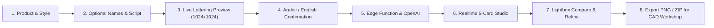

# Majestic Custom Jewellery Designer — Showroom Atelier

[](https://github.com/majesticsince1970-svg/Majestic-Custom-Jewellery-Designer)
[](https://reactjs.org/)
[](https://vitejs.dev/)
[](https://tailwindcss.com/)
[](https://supabase.com/)
[](https://openai.com/)

A bespoke luxury web application designed for **Majestic Showroom Staff** to craft personalized custom jewellery concepts (Rings, Pendants, Lockets, Bracelets, Earrings) with clients at the showroom counter.

---

## 🌟 Key Capabilities

1. **Product-Driven Wizard**:
   - **Main Choices**: Custom Rings (Indian sizes 6–30, band widths thin/medium/wide) and Pendants (cut-out names, bars, coin medallions, royal filigree).
   - **More Categories**: Keepsake Lockets (photo space, Victorian oval/heart), Luxury Bracelets (cuffs, name bars, charm chains), Designer Earrings (studs & drops).
   - Dynamic options adapt immediately to the chosen product.

2. **Ground Truth Vector Lettering & Calligraphy**:
   - High-resolution **1024×1024** typography drawn live on HTML Canvas before generation.
   - Native browser font shaping for **Arabic Ruqaa, Amiri, and Kufi** (preserving joined forms, dots, and ligatures) and **English Cursive / Roman Capitals** (Great Vibes, Playfair Display, Cinzel).
   - Mandatory **Arabic Spelling Confirmation** to eliminate AI spelling mistakes.
   - Dual-script mode (English stacked over Arabic) and couple names (e.g. "Hadi & Sara").

3. **5 Distinct Design Presets per Product**:
   - Generates five curated variations exploring metal alloys (22K Yellow, 18K White, 18K Rose, Two-tone, Platinum), finishes (mirror high polish, satin brushed, micro-matte), and gemstone accents (natural emeralds, Burma rubies, Ceylon sapphires, diamond pavé).

4. **Showroom Results Studio**:
   - Live **Supabase Realtime** streaming of generated concept images.
   - **Side-by-Side Lightbox**: Inspect generated concept directly beside the customer's vector lettering artwork.
   - **One-Click Refine**: Modify designs with custom atelier instructions (e.g., *"Make band thinner"*).
   - **Multi-Select & Bulk ZIP Download**: Download individual PNGs named `Majestic_{name}_{preset}.png` or export selected designs as a bundled ZIP.

5. **Security & Production Readiness**:
   - Row Level Security (RLS) on all database tables.
   - Private Supabase storage buckets (`lettering`, `references`, `designs`) with 10-minute signed URLs.
   - Daily rate limiting and admin preset customization dashboard.

---

## 🛠️ Tech Stack

- **Frontend**: React 18, Vite 6, TypeScript, Tailwind CSS, Lucide Icons
- **Backend & Database**: Supabase PostgreSQL 17, Supabase Auth, Supabase Storage, Supabase Realtime
- **AI Image Generation**: OpenAI Images API (`gpt-image-2` / `dall-e-3`)
- **Typography**: Google Fonts (*Great Vibes*, *Aref Ruqaa*, *Playfair Display*, *Amiri*, *Reem Kufi*, *Cinzel*)
- **Exporting**: JSZip, FileSaver

---

## 🚀 Quickstart

### Prerequisites
- Node.js (v18+)
- npm or pnpm

### Setup
```bash
# Clone the repository
git clone https://github.com/majesticsince1970-svg/Majestic-Custom-Jewellery-Designer.git
cd Majestic-Custom-Jewellery-Designer

# Install dependencies
npm install

# Start development server
npm run dev
```

### Environment Variables
Configure `.env`:
```env
VITE_SUPABASE_URL=https://mkuewuvwbbyzsjcuzzau.supabase.co
VITE_SUPABASE_ANON_KEY=your_supabase_anon_key
```

---

## 🏢 Showroom Production Workflow



---

© 1970–2026 Majestic Jewellers. All rights reserved.

